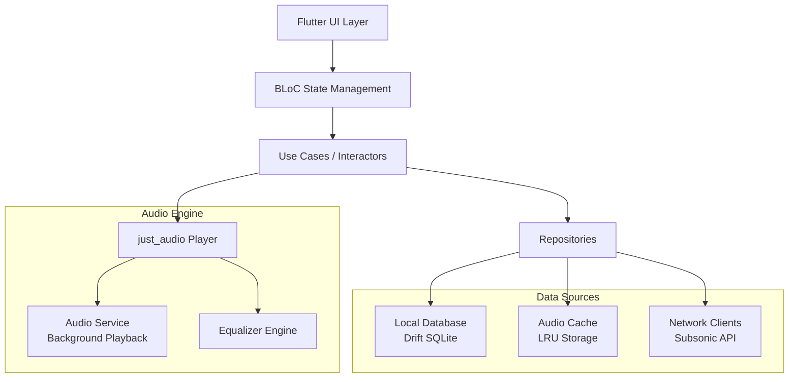

# OmniSonic Design Document

## Overview

OmniSonic is a cross-platform music client built with Flutter that provides a unified interface for multiple Subsonic/Navidrome servers. The application follows Clean Architecture principles with a focus on offline-first functionality, high-performance audio playback, and premium user experience.

The system consists of three main layers:
- **Presentation Layer**: Flutter UI with BLoC state management
- **Domain Layer**: Business logic and use cases
- **Data Layer**: Local database (Drift), network clients, and caching

## Architecture

### High-Level Architecture



### Clean Architecture Layers

**Presentation Layer:**
- Flutter widgets and screens
- BLoC pattern for state management
- Platform-specific UI adaptations (Material 3, Cupertino)
- Hero animations and shared element transitions

**Domain Layer:**
- Use cases for core business logic
- Entity models (Artist, Album, Track, Server)
- Repository interfaces
- Audio playback abstractions

**Data Layer:**
- Drift database for metadata storage
- Subsonic API clients
- Audio file caching system
- Secure credential storage

## Components and Interfaces

### Core Components

#### 1. Multi-Server Manager
```dart
abstract class ServerRepository {
  Future<List<Server>> getConfiguredServers();
  Future<void> addServer(ServerConfig config);
  Future<void> removeServer(String serverId);
  Future<bool> validateServerConnection(ServerConfig config);
}

class ServerConfig {
  final String id;
  final String name;
  final String url;
  final String username;
  final String password; // Stored securely
  final AuthType authType;
}
```

#### 2. Unified Content Repository
```dart
abstract class MusicRepository {
  Future<List<Artist>> getArtists({String? query});
  Future<List<Album>> getAlbumsByArtist(String artistId);
  Future<List<Track>> getTracksByAlbum(String albumId);
  Future<void> syncMetadata(List<String> serverIds);
  Stream<SyncProgress> watchSyncProgress();
}

class UnifiedArtist {
  final String id;
  final String name;
  final String? musicBrainzId;
  final List<ServerSource> sources;
  final String? imageUrl;
}
```

#### 3. Audio Engine
```dart
abstract class AudioPlayer {
  Future<void> setPlaylist(List<Track> tracks, {int initialIndex = 0});
  Future<void> play();
  Future<void> pause();
  Future<void> seekToNext();
  Future<void> seekToPrevious();
  Stream<PlaybackState> get playbackStateStream;
  Stream<Duration> get positionStream;
}

class AudioService {
  final JustAudioPlayer _player;
  final AudioServiceBackground _background;
  final EqualizerEngine _equalizer;
}
```

#### 4. Cache Manager
```dart
abstract class CacheRepository {
  Future<String?> getCachedTrackPath(String trackId);
  Future<void> cacheTrack(String trackId, Stream<List<int>> audioStream);
  Future<void> pinTrack(String trackId);
  Future<void> unpinTrack(String trackId);
  Future<void> clearCache({bool keepPinned = true});
  Future<CacheStats> getCacheStats();
}

class CacheStats {
  final int totalSize;
  final int pinnedSize;
  final int availableSpace;
  final List<CachedTrack> recentlyUsed;
}
```

## Data Models

### Database Schema (Drift)

```dart
// Server configuration table
class Servers extends Table {
  TextColumn get id => text()();
  TextColumn get name => text()();
  TextColumn get url => text()();
  TextColumn get username => text()();
  BoolColumn get isActive => boolean().withDefault(const Constant(true))();
  DateTimeColumn get lastSync => dateTime().nullable()();
  
  @override
  Set<Column> get primaryKey => {id};
}

// Artists table with server source tracking
class Artists extends Table {
  TextColumn get id => text()();
  TextColumn get name => text()();
  TextColumn get musicBrainzId => text().nullable()();
  TextColumn get imageUrl => text().nullable()();
  DateTimeColumn get createdAt => dateTime()();
  
  @override
  Set<Column> get primaryKey => {id};
}

// Artist-Server mapping for unified view
class ArtistSources extends Table {
  TextColumn get artistId => text().references(Artists, #id)();
  TextColumn get serverId => text().references(Servers, #id)();
  TextColumn get serverArtistId => text()();
  
  @override
  Set<Column> get primaryKey => {artistId, serverId};
}

// Albums table
class Albums extends Table {
  TextColumn get id => text()();
  TextColumn get title => text()();
  TextColumn get artistId => text().references(Artists, #id)();
  TextColumn get serverId => text().references(Servers, #id)();
  TextColumn get serverAlbumId => text()();
  IntColumn get year => integer().nullable()();
  TextColumn get genre => text().nullable()();
  TextColumn get coverArtUrl => text().nullable()();
  DateTimeColumn get createdAt => dateTime()();
  
  @override
  Set<Column> get primaryKey => {id};
}

// Tracks table
class Tracks extends Table {
  TextColumn get id => text()();
  TextColumn get title => text()();
  TextColumn get albumId => text().references(Albums, #id)();
  TextColumn get serverId => text().references(Servers, #id)();
  TextColumn get serverTrackId => text()();
  IntColumn get trackNumber => integer().nullable()();
  IntColumn get duration => integer().nullable()(); // seconds
  TextColumn get format => text()(); // mp3, flac, etc.
  IntColumn get bitrate => integer().nullable()();
  BoolColumn get isPinned => boolean().withDefault(const Constant(false))();
  TextColumn get cachedPath => text().nullable()();
  DateTimeColumn get lastPlayed => dateTime().nullable()();
  
  @override
  Set<Column> get primaryKey => {id};
}

// Cache metadata table
class CacheEntries extends Table {
  TextColumn get trackId => text().references(Tracks, #id)();
  TextColumn get filePath => text()();
  IntColumn get fileSize => integer()();
  BoolColumn get isPinned => boolean()();
  DateTimeColumn get lastAccessed => dateTime()();
  DateTimeColumn get createdAt => dateTime()();
  
  @override
  Set<Column> get primaryKey => {trackId};
}
```

### Entity Models

```dart
class Track {
  final String id;
  final String title;
  final String albumId;
  final String serverId;
  final int? trackNumber;
  final Duration? duration;
  final AudioFormat format;
  final int? bitrate;
  final bool isPinned;
  final String? cachedPath;
  final DateTime? lastPlayed;
}

class Album {
  final String id;
  final String title;
  final String artistId;
  final String serverId;
  final int? year;
  final String? genre;
  final String? coverArtUrl;
  final List<Track> tracks;
}

class Artist {
  final String id;
  final String name;
  final String? musicBrainzId;
  final String? imageUrl;
  final List<ServerSource> sources;
  final List<Album> albums;
}
```

## Correctness Properties

*A property is a characteristic or behavior that should hold true across all valid executions of a system-essentially, a formal statement about what the system should do. Properties serve as the bridge between human-readable specifications and machine-verifiable correctness guarantees.*

### Property Reflection

After reviewing all properties identified in the prework, several can be consolidated to eliminate redundancy:

**Consolidations:**
- Properties 1.1, 1.2, 1.3 can be combined into a comprehensive server management property
- Properties 2.2, 2.3, 2.4, 2.5 can be combined into a unified content aggregation property  
- Properties 4.1, 4.2, 4.4 can be combined into a comprehensive caching behavior property
- Properties 7.1, 7.2, 7.3, 7.4 can be combined into a privacy and security property
- Properties 8.1, 8.2, 8.3, 8.4, 8.5 can be combined into a background sync management property

This reduces redundancy while maintaining comprehensive coverage of all functional requirements.

### Core Correctness Properties

**Property 1: Server Configuration Management**
*For any* valid server configuration, adding it to the system should result in successful authentication, secure storage, and the ability to retrieve metadata, while invalid configurations should produce appropriate error messages and allow correction.
**Validates: Requirements 1.1, 1.2, 1.3, 1.4**

**Property 2: Server Cleanup Consistency**  
*For any* server that is removed from configuration, all associated cached content and metadata should be completely removed from the local system.
**Validates: Requirements 1.5**

**Property 3: Unified Content Aggregation**
*For any* set of servers containing duplicate artists (by name or MusicBrainz ID), the unified view should display them as single entries while preserving all albums from all sources and maintaining source attribution.
**Validates: Requirements 2.1, 2.2, 2.3, 2.4, 2.5**

**Property 4: Audio Format and Playback Support**
*For any* supported audio format (MP3, FLAC, AAC, OGG, Opus), the system should be able to play the file with appropriate transcoding requests based on network conditions and apply ReplayGain normalization when metadata is available.
**Validates: Requirements 3.1, 3.3, 3.4**

**Property 5: Gapless Playback Continuity**
*For any* playlist or album, transitioning between consecutive tracks should maintain seamless audio continuity without gaps or interruptions.
**Validates: Requirements 3.2**

**Property 6: Real-time Audio Processing**
*For any* equalizer adjustment made during playback, the audio output should reflect the changes immediately without interrupting playback.
**Validates: Requirements 3.5**

**Property 7: Intelligent Cache Management**
*For any* audio streaming session, files should be automatically cached using LRU eviction within configured size limits, while explicitly pinned content should be preserved during cache cleanup operations.
**Validates: Requirements 4.1, 4.2, 4.4**

**Property 8: Offline Mode Filtering**
*For any* content library, enabling offline mode should display only locally cached content while hiding unavailable items.
**Validates: Requirements 4.3**

**Property 9: Playback Continuity During Network Loss**
*For any* active playback session, losing network connectivity should not interrupt playback if the current and upcoming tracks are cached locally.
**Validates: Requirements 4.5**

**Property 10: UI Animation Consistency**
*For any* navigation between screens involving album artwork, hero animations should be used to create smooth visual transitions.
**Validates: Requirements 5.2**

**Property 11: Adaptive Image Resolution**
*For any* album artwork display, list views should show thumbnail resolution while detail views should show high-resolution images.
**Validates: Requirements 5.3**

**Property 12: Dynamic Theme Updates**
*For any* track change during playback, the application theme should update to reflect colors derived from the new album artwork.
**Validates: Requirements 5.4**

**Property 13: Immediate Theme Application**
*For any* theme change (light, dark, OLED), the new theme should be applied immediately throughout the application without requiring a restart.
**Validates: Requirements 5.5**

**Property 14: Voice Command Response**
*For any* basic playback voice command (play, pause, next, previous), the system should execute the appropriate action when connected to automotive systems.
**Validates: Requirements 6.3**

**Property 15: Automotive Playback Continuity**
*For any* active playback session, disconnecting from automotive systems should allow playback to continue seamlessly on the device.
**Validates: Requirements 6.5**

**Property 16: Privacy and Security Compliance**
*For any* application operation, server credentials should be stored using platform secure storage, no telemetry should be transmitted to third parties, network communication should only occur with user-configured servers, and cached files should be stored in application-private directories.
**Validates: Requirements 7.1, 7.2, 7.3, 7.4**

**Property 17: Background Sync Management**
*For any* background sync operation, the system should periodically update metadata from configured servers, handle errors with exponential backoff, respect battery optimization settings, and honor user preferences for background sync enablement.
**Validates: Requirements 8.1, 8.2, 8.3, 8.4, 8.5**

## Error Handling

### Network Error Handling
- **Connection Failures**: Graceful degradation to cached content
- **Authentication Errors**: Clear error messages with retry mechanisms
- **Timeout Handling**: Configurable timeouts with exponential backoff
- **Rate Limiting**: Respect server rate limits with appropriate delays

### Audio Playback Error Handling
- **Format Errors**: Fallback to transcoded versions
- **Streaming Interruptions**: Seamless switching to cached versions
- **Hardware Issues**: Graceful error reporting and recovery
- **Buffer Underruns**: Intelligent buffering strategies

### Data Consistency Error Handling
- **Database Corruption**: Automatic repair and re-sync mechanisms
- **Cache Corruption**: Automatic cache invalidation and re-download
- **Metadata Conflicts**: Conflict resolution using timestamps and source priority

## Testing Strategy

### Dual Testing Approach

The testing strategy employs both unit testing and property-based testing to ensure comprehensive coverage:

**Unit Testing:**
- Specific examples demonstrating correct behavior
- Integration points between components  
- Edge cases and error conditions
- Platform-specific functionality

**Property-Based Testing:**
- Universal properties that should hold across all inputs
- Configured to run minimum 100 iterations per test
- Each property test tagged with format: **Feature: omnisonic-music-client, Property {number}: {property_text}**
- Uses the `fast_check` library for Dart/Flutter property-based testing

**Testing Framework Configuration:**
- Primary testing framework: `flutter_test` for unit tests
- Property-based testing: `fast_check` package for Dart
- Integration testing: `integration_test` package for end-to-end scenarios
- Mock framework: `mockito` for dependency isolation

**Test Organization:**
- Unit tests co-located with source files using `.test.dart` suffix
- Property tests in dedicated `test/properties/` directory
- Integration tests in `integration_test/` directory
- Test utilities and fixtures in `test/helpers/` directory

**Coverage Requirements:**
- Minimum 80% code coverage for core business logic
- 100% coverage for critical paths (authentication, audio playback, data sync)
- Property tests must validate all 17 correctness properties
- Integration tests must cover complete user workflows

### Performance Testing
- Audio latency measurements
- UI frame rate monitoring during large list scrolling
- Memory usage profiling during extended playback sessions
- Battery consumption analysis for background operations

### Platform Testing
- iOS and Android device testing
- CarPlay and Android Auto integration testing
- Desktop platform testing (Windows, macOS, Linux)
- Web platform compatibility testing

## Implementation Notes

### Audio Engine Integration
- Use `just_audio` with `audio_service` for background playback
- Configure gapless playback through playlist management
- Implement custom equalizer using platform-specific audio processing
- Handle platform-specific audio session management

### Database Optimization
- Create indexes on frequently queried columns (artist name, album title)
- Use database transactions for batch operations
- Implement database migration strategies for schema updates
- Optimize queries for large music libraries (50,000+ tracks)

### Caching Strategy
- Implement LRU cache with configurable size limits (2GB-10GB)
- Use content-based hashing for cache key generation
- Implement cache warming for frequently accessed content
- Handle cache corruption through automatic re-download

### UI Performance Optimization
- Use `ListView.builder` with item extent for large lists
- Implement image caching with multiple resolution tiers
- Use `RepaintBoundary` widgets to isolate expensive repaints
- Optimize hero animations with custom flight shuttle builders

### Security Implementation
- Use `flutter_secure_storage` for credential management
- Implement certificate pinning for server connections
- Use HTTPS for all network communications
- Implement proper session management and token refresh