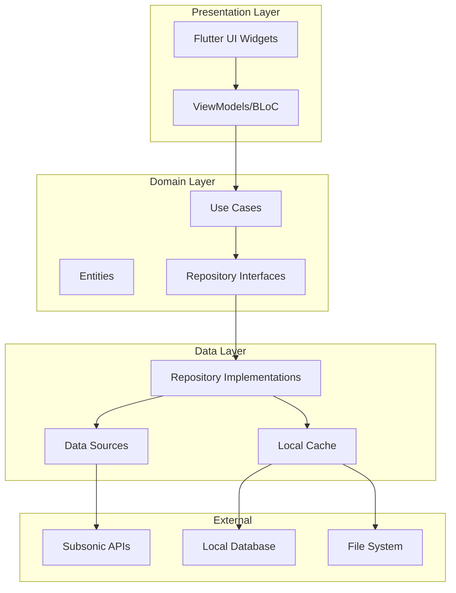

# Design Document

## Overview

Omnisonic is a cross-platform music streaming client built with Flutter that provides a unified music collection experience across multiple Subsonic-compatible servers. The application implements a clean architecture pattern with clear separation between presentation, domain, and data layers, ensuring maintainability and testability across all supported platforms (macOS, iOS, Windows, Android, Linux).

The design emphasizes performance, user experience, and reliability through intelligent caching, deduplication algorithms, and robust error handling. The architecture supports offline functionality, real-time synchronization, and seamless multi-server integration while maintaining a modern Spotify-like interface.

## Architecture

### High-Level Architecture



### Clean Architecture Layers

**Presentation Layer:**
- Flutter widgets implementing Spotify-like UI components
- ViewModels using ChangeNotifier for state management
- BLoC pattern for complex state flows (audio playback, sync)
- Platform-specific adaptations for different screen sizes

**Domain Layer:**
- Business entities (Track, Album, Artist, Server, Playlist)
- Use cases encapsulating business logic
- Repository interfaces defining data contracts
- Domain services for deduplication and aggregation

**Data Layer:**
- Repository implementations handling data orchestration
- Remote data sources for Subsonic API communication
- Local data sources for caching and offline storage
- Database abstraction using SQLite/Drift

## Components and Interfaces

### Core Entities

```dart
// Domain Entities
class Track {
  final String id;
  final String title;
  final String artist;
  final String album;
  final Duration duration;
  final String serverId;
  final String streamUrl;
  final AudioQuality quality;
  final DateTime lastModified;
}

class MusicServer {
  final String id;
  final String name;
  final String url;
  final String username;
  final ServerStatus status;
  final DateTime lastSync;
}

class UnifiedCollection {
  final List<Track> tracks;
  final List<Album> albums;
  final List<Artist> artists;
  final Map<String, List<String>> duplicateGroups;
}
```

### Repository Interfaces

```dart
abstract class MusicRepository {
  Future<Result<List<Track>>> getAllTracks();
  Future<Result<List<Album>>> getAllAlbums();
  Future<Result<List<Artist>>> getAllArtists();
  Stream<UnifiedCollection> observeCollection();
  Future<Result<void>> syncFromServers();
}

abstract class ServerRepository {
  Future<Result<void>> addServer(MusicServer server);
  Future<Result<void>> removeServer(String serverId);
  Future<Result<List<MusicServer>>> getAllServers();
  Stream<List<MusicServer>> observeServers();
  Future<Result<void>> testConnection(MusicServer server);
}

abstract class PlaybackRepository {
  Future<Result<void>> play(Track track);
  Future<Result<void>> pause();
  Future<Result<void>> stop();
  Stream<PlaybackState> observePlaybackState();
  Future<Result<void>> setQueue(List<Track> tracks);
}
```

### Key Use Cases

```dart
class SyncMusicCollectionUseCase {
  Future<Result<void>> execute() async {
    // 1. Fetch metadata from all connected servers
    // 2. Run deduplication algorithm
    // 3. Update unified collection
    // 4. Notify observers of changes
  }
}

class PlayTrackUseCase {
  Future<Result<void>> execute(Track track) async {
    // 1. Select best available server for track
    // 2. Handle server failover if needed
    // 3. Start audio streaming
    // 4. Update playback state
  }
}

class DeduplicateTracksUseCase {
  Future<Result<Map<String, List<Track>>>> execute(List<Track> tracks) async {
    // 1. Group tracks by similarity score
    // 2. Apply user preferences for duplicates
    // 3. Return duplicate groups for UI display
  }
}
```

## Data Models

### Database Schema

```sql
-- Servers table
CREATE TABLE servers (
  id TEXT PRIMARY KEY,
  name TEXT NOT NULL,
  url TEXT NOT NULL,
  username TEXT NOT NULL,
  encrypted_password TEXT NOT NULL,
  status TEXT NOT NULL,
  last_sync INTEGER,
  created_at INTEGER NOT NULL
);

-- Tracks table
CREATE TABLE tracks (
  id TEXT PRIMARY KEY,
  server_id TEXT NOT NULL,
  title TEXT NOT NULL,
  artist TEXT NOT NULL,
  album TEXT NOT NULL,
  duration_ms INTEGER NOT NULL,
  stream_url TEXT NOT NULL,
  quality TEXT NOT NULL,
  file_size INTEGER,
  last_modified INTEGER,
  is_cached BOOLEAN DEFAULT FALSE,
  cache_path TEXT,
  FOREIGN KEY (server_id) REFERENCES servers (id)
);

-- Duplicate groups table
CREATE TABLE duplicate_groups (
  id TEXT PRIMARY KEY,
  representative_track_id TEXT NOT NULL,
  created_at INTEGER NOT NULL,
  FOREIGN KEY (representative_track_id) REFERENCES tracks (id)
);

-- Duplicate group members table
CREATE TABLE duplicate_group_members (
  group_id TEXT NOT NULL,
  track_id TEXT NOT NULL,
  similarity_score REAL NOT NULL,
  PRIMARY KEY (group_id, track_id),
  FOREIGN KEY (group_id) REFERENCES duplicate_groups (id),
  FOREIGN KEY (track_id) REFERENCES tracks (id)
);

-- Playlists table
CREATE TABLE playlists (
  id TEXT PRIMARY KEY,
  name TEXT NOT NULL,
  created_at INTEGER NOT NULL,
  updated_at INTEGER NOT NULL
);

-- Playlist tracks table
CREATE TABLE playlist_tracks (
  playlist_id TEXT NOT NULL,
  track_id TEXT NOT NULL,
  position INTEGER NOT NULL,
  PRIMARY KEY (playlist_id, track_id),
  FOREIGN KEY (playlist_id) REFERENCES playlists (id),
  FOREIGN KEY (track_id) REFERENCES tracks (id)
);
```

### Subsonic API Integration

```dart
class SubsonicApiClient {
  Future<Result<List<Track>>> getAlbumTracks(String albumId) async {
    final response = await _httpClient.get(
      '$baseUrl/rest/getAlbum',
      queryParameters: {
        'id': albumId,
        'u': username,
        't': _generateToken(),
        's': _generateSalt(),
        'v': '1.16.1',
        'c': 'Omnisonic',
        'f': 'json',
      },
    );
    
    if (response.statusCode == 200) {
      return Result.ok(_parseTracksFromResponse(response.data));
    } else {
      return Result.error(SubsonicApiException(response.statusCode));
    }
  }
  
  String getStreamUrl(String trackId) {
    return '$baseUrl/rest/stream?id=$trackId&u=$username&t=${_generateToken()}&s=${_generateSalt()}&v=1.16.1&c=Omnisonic';
  }
}
```

## Correctness Properties

*A property is a characteristic or behavior that should hold true across all valid executions of a system-essentially, a formal statement about what the system should do. Properties serve as the bridge between human-readable specifications and machine-verifiable correctness guarantees.*

### Property 1: Server Connection Validation
*For any* server URL and credential combination, when attempting to connect, the system should validate the URL format, test authentication using Subsonic API, and store encrypted credentials locally if successful.
**Validates: Requirements 1.1, 1.2**

### Property 2: Server Fault Tolerance
*For any* server failure scenario, the system should mark unavailable servers as offline and continue operating with remaining available servers without data loss.
**Validates: Requirements 1.3**

### Property 3: Multi-Server Capacity
*For any* collection of up to 10 server connections, the system should maintain simultaneous connections and provide unified access to all server content.
**Validates: Requirements 1.4**

### Property 4: Server Configuration Updates
*For any* server setting modification, the system should update the connection parameters and automatically re-sync metadata from the affected server.
**Validates: Requirements 1.5**

### Property 5: Unified Collection Synchronization
*For any* set of connected servers, the system should fetch all metadata, create a unified collection, and automatically update when new content is detected on any server within 5 minutes.
**Validates: Requirements 2.1, 2.2, 2.5**

### Property 6: Source Information Preservation
*For any* track in the unified collection, the system should maintain accurate server source information while presenting a unified view to the user.
**Validates: Requirements 2.3**

### Property 7: Cross-Server Search
*For any* search query, the system should search simultaneously across all connected servers and return comprehensive results from all sources.
**Validates: Requirements 2.4**

### Property 8: Duplicate Detection Algorithm
*For any* set of tracks with identical title, artist, album, and duration, the deduplication engine should identify them as duplicates and display only one entry in the unified collection.
**Validates: Requirements 3.1, 3.2, 3.3**

### Property 9: Optimal Source Selection
*For any* deduplicated track, when playing, the system should select the best available source based on audio quality and server availability.
**Validates: Requirements 3.4**

### Property 10: User Duplicate Preferences
*For any* manual duplicate marking by the user, the system should respect these preferences and override automatic detection results.
**Validates: Requirements 3.5**

### Property 11: Audio Streaming Initiation
*For any* valid track selection, the system should initiate streaming using the Subsonic API stream endpoint and support all common audio formats (MP3, FLAC, OGG, AAC).
**Validates: Requirements 4.1, 4.2**

### Property 12: Adaptive Streaming Quality
*For any* network condition change, the system should automatically adapt streaming quality to maintain optimal playback experience.
**Validates: Requirements 4.3**

### Property 13: Gapless Playback Continuity
*For any* sequence of tracks in playlists or albums, the system should provide gapless playback transitions between tracks.
**Validates: Requirements 4.4**

### Property 14: Playback Server Failover
*For any* server failure during playback, if the same track exists on alternative servers, the system should attempt to continue playback from an available source.
**Validates: Requirements 4.5**

### Property 15: Content Display Completeness
*For any* music content (albums, artists, playlists), the system should display all required elements including artwork, metadata, track listings, and durations.
**Validates: Requirements 5.2, 6.3, 6.5**

### Property 16: UI Response Performance
*For any* user interface interaction, the system should respond within 100ms to maintain optimal user experience.
**Validates: Requirements 5.4**

### Property 17: Responsive Layout Adaptation
*For any* screen size and orientation on supported platforms, the system should adapt the interface layout appropriately.
**Validates: Requirements 5.5**

### Property 18: Real-Time Search Results
*For any* search query, the system should provide real-time results across tracks, albums, artists, and playlists.
**Validates: Requirements 6.1**

### Property 19: Multi-Dimensional Filtering
*For any* filter criteria (genre, year, server source, audio quality), the system should correctly filter content across all specified dimensions.
**Validates: Requirements 6.2**

### Property 20: Smart Collection Generation
*For any* user activity, the system should generate and maintain accurate recently played, most played, and recently added smart collections.
**Validates: Requirements 6.4**

### Property 21: Comprehensive Playlist Operations
*For any* playlist operation (creation, editing, deletion, reordering, adding tracks from any server), the system should execute the operation successfully and persist changes locally.
**Validates: Requirements 7.1, 7.2, 7.3**

### Property 22: Queue Management Operations
*For any* play queue modification (adding, removing, reordering tracks), the system should update the queue state correctly and maintain playback continuity.
**Validates: Requirements 7.3**

### Property 23: Playlist Persistence and Sync
*For any* playlist, the system should persist it locally and sync across devices when connectivity allows.
**Validates: Requirements 7.4**

### Property 24: Unavailable Track Handling
*For any* playlist containing unavailable tracks, the system should skip unavailable tracks and continue playback with available tracks.
**Validates: Requirements 7.5**

### Property 25: Offline Content Caching
*For any* content marked for offline access, the system should download and cache audio files locally with appropriate cache management and size limits.
**Validates: Requirements 8.1, 8.2**

### Property 26: Offline Functionality Access
*For any* cached content, when offline, the system should provide full playback functionality without network connectivity.
**Validates: Requirements 8.3**

### Property 27: Cache Priority Management
*For any* cache management scenario, the system should prioritize recently accessed and user-favorited content when storage limits are reached.
**Validates: Requirements 8.5**

### Property 28: Cross-Device Synchronization
*For any* playback state change, user preference, or playlist modification, the system should sync the changes across all user devices and handle conflicts by prioritizing recent changes.
**Validates: Requirements 9.1, 9.2, 9.4**

### Property 29: Playback Continuity Across Devices
*For any* device switch, the system should allow users to continue playback from where they left off on the previous device.
**Validates: Requirements 9.3**

### Property 30: Automatic Sync on Connectivity Restoration
*For any* network connectivity restoration, the system should automatically sync all pending changes across devices and offline content preferences.
**Validates: Requirements 9.5, 8.4**

### Property 31: Performance Requirements
*For any* platform, the system should start within 3 seconds, use no more than 100MB RAM during streaming, and minimize CPU usage and battery consumption in background mode.
**Validates: Requirements 10.1, 10.2, 10.4**

### Property 32: Image Caching Efficiency
*For any* album artwork request, the system should implement efficient caching to minimize redundant network requests.
**Validates: Requirements 10.3**

### Property 33: Large Collection Performance
*For any* music collection up to 100,000+ tracks, the system should maintain performance without degradation in response times or functionality.
**Validates: Requirements 10.5**

<function_calls>
<invoke name="prework">
<parameter name="featureName">omnisonic-music-client

## Error Handling

### Network Error Handling

```dart
class NetworkErrorHandler {
  static Future<Result<T>> handleNetworkCall<T>(
    Future<T> Function() networkCall,
  ) async {
    try {
      final result = await networkCall();
      return Result.ok(result);
    } on SocketException {
      return Result.error(NetworkException('No internet connection'));
    } on TimeoutException {
      return Result.error(NetworkException('Request timeout'));
    } on HttpException catch (e) {
      return Result.error(NetworkException('HTTP error: ${e.message}'));
    } catch (e) {
      return Result.error(UnknownException('Unexpected error: $e'));
    }
  }
}
```

### Server Connection Error Handling

- **Connection Timeout**: Retry with exponential backoff (1s, 2s, 4s, 8s)
- **Authentication Failure**: Prompt user to re-enter credentials
- **Server Unavailable**: Mark server as offline, continue with available servers
- **API Version Mismatch**: Log warning, attempt compatibility mode
- **Rate Limiting**: Implement request queuing with appropriate delays

### Audio Playback Error Handling

- **Stream Interruption**: Attempt to resume from last position
- **Format Not Supported**: Skip track and notify user
- **Server Failover**: Automatically switch to alternative server for same track
- **Cache Corruption**: Re-download corrupted files
- **Audio Device Issues**: Gracefully handle device disconnection/reconnection

### Data Synchronization Error Handling

- **Sync Conflicts**: Use last-write-wins with user notification for important conflicts
- **Partial Sync Failure**: Continue with successful operations, retry failed items
- **Storage Full**: Implement intelligent cache eviction based on usage patterns
- **Database Corruption**: Automatic backup restoration with user notification

## Testing Strategy

### Dual Testing Approach

The application will use both unit testing and property-based testing to ensure comprehensive coverage:

**Unit Tests:**
- Test specific examples and edge cases for individual components
- Verify integration points between layers
- Test error conditions and boundary values
- Focus on concrete scenarios and known failure modes

**Property-Based Tests:**
- Verify universal properties across all inputs using randomized testing
- Test correctness properties defined in the design document
- Use minimum 100 iterations per property test for thorough coverage
- Each property test references its corresponding design property

### Property-Based Testing Configuration

**Framework**: Use `test` package with custom property testing utilities for Flutter
**Test Configuration**:
- Minimum 100 iterations per property test
- Custom generators for domain objects (Track, Album, Server, etc.)
- Shrinking support to find minimal failing examples
- Tag format: **Feature: omnisonic-music-client, Property {number}: {property_text}**

### Testing Libraries and Tools

**Core Testing:**
- `flutter_test` for widget and unit testing
- `mockito` for mocking dependencies
- `integration_test` for end-to-end testing across platforms

**Property-Based Testing:**
- Custom property testing framework built on `test` package
- Generators for music domain objects
- Property test runners with configurable iteration counts

**Performance Testing:**
- `flutter_driver` for performance profiling
- Memory usage monitoring during streaming
- Startup time measurement across platforms
- Battery usage testing on mobile platforms

### Test Categories

**Unit Tests:**
- Repository implementations
- Use case business logic
- Data model serialization/deserialization
- API client functionality
- Deduplication algorithms

**Widget Tests:**
- UI component rendering
- User interaction handling
- State management integration
- Platform-specific adaptations

**Integration Tests:**
- End-to-end user workflows
- Multi-server synchronization
- Offline/online mode transitions
- Cross-platform functionality

**Property Tests:**
- All 33 correctness properties from design document
- Randomized input validation
- Invariant preservation across operations
- Round-trip properties for serialization

### Continuous Integration

**Automated Testing Pipeline:**
- Run all unit and widget tests on every commit
- Execute property tests with extended iteration counts nightly
- Performance regression testing on release candidates
- Cross-platform testing matrix for all supported platforms

**Quality Gates:**
- Minimum 90% code coverage for core business logic
- All property tests must pass with 100 iterations
- Performance benchmarks must not regress by more than 10%
- No critical or high-severity static analysis issues