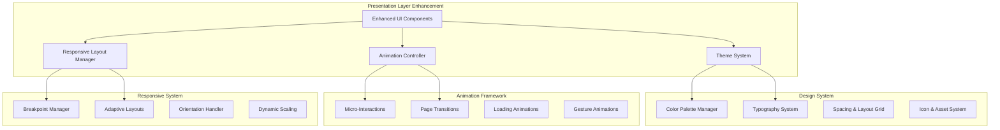

# Design Document

## Overview

The Omnisonic UI Enhancement transforms the existing functional music client into a visually stunning, modern application that rivals premium music streaming services. The design implements a sophisticated color system, fluid animations, and responsive layouts using Flutter's advanced UI capabilities and Material Design 3 principles.

The enhancement focuses on creating an immersive music experience through carefully crafted visual elements, smooth micro-interactions, and adaptive interfaces that respond intelligently to user context and device capabilities. The design maintains the existing clean architecture while adding a comprehensive theming system and animation framework.

## Architecture

### UI Architecture Overview



### Theme System Architecture

The theme system provides a centralized approach to managing colors, typography, and visual styles across the entire application:

```dart
class OmnisonicTheme {
  static ThemeData lightTheme = ThemeData(
    useMaterial3: true,
    colorScheme: _lightColorScheme,
    textTheme: _textTheme,
    extensions: [
      OmnisonicColorExtension.light,
      OmnisonicAnimationExtension(),
    ],
  );
  
  static ThemeData darkTheme = ThemeData(
    useMaterial3: true,
    colorScheme: _darkColorScheme,
    textTheme: _textTheme,
    extensions: [
      OmnisonicColorExtension.dark,
      OmnisonicAnimationExtension(),
    ],
  );
}
```

### Animation Framework Architecture

A comprehensive animation system that provides consistent, performant animations throughout the app:

```dart
class AnimationManager {
  static const Duration fastDuration = Duration(milliseconds: 200);
  static const Duration normalDuration = Duration(milliseconds: 300);
  static const Duration slowDuration = Duration(milliseconds: 500);
  
  static const Curve standardCurve = Curves.easeInOutCubic;
  static const Curve bounceCurve = Curves.elasticOut;
  static const Curve slideCurve = Curves.easeOutQuart;
}
```

## Components and Interfaces

### Enhanced Color System

```dart
class OmnisonicColors {
  // Primary Brand Colors
  static const Color primaryPurple = Color(0xFF6366F1);
  static const Color primaryBlue = Color(0xFF3B82F6);
  static const Color primaryTeal = Color(0xFF06B6D4);
  
  // Gradient Definitions
  static const LinearGradient primaryGradient = LinearGradient(
    colors: [primaryPurple, primaryBlue],
    begin: Alignment.topLeft,
    end: Alignment.bottomRight,
  );
  
  static const LinearGradient accentGradient = LinearGradient(
    colors: [primaryBlue, primaryTeal],
    begin: Alignment.topCenter,
    end: Alignment.bottomCenter,
  );
  
  // Semantic Colors
  static const Color success = Color(0xFF10B981);
  static const Color warning = Color(0xFFF59E0B);
  static const Color error = Color(0xFFEF4444);
  static const Color info = Color(0xFF3B82F6);
  
  // Surface Colors (Light Mode)
  static const Color surfaceLight = Color(0xFFFAFAFA);
  static const Color cardLight = Color(0xFFFFFFFF);
  static const Color backgroundLight = Color(0xFFF8FAFC);
  
  // Surface Colors (Dark Mode)
  static const Color surfaceDark = Color(0xFF1E1E1E);
  static const Color cardDark = Color(0xFF2D2D2D);
  static const Color backgroundDark = Color(0xFF121212);
}
```

### Typography System

```dart
class OmnisonicTypography {
  static const String primaryFont = 'Inter';
  static const String displayFont = 'Poppins';
  
  static const TextStyle displayLarge = TextStyle(
    fontFamily: displayFont,
    fontSize: 32,
    fontWeight: FontWeight.w700,
    letterSpacing: -0.5,
    height: 1.2,
  );
  
  static const TextStyle headlineMedium = TextStyle(
    fontFamily: primaryFont,
    fontSize: 24,
    fontWeight: FontWeight.w600,
    letterSpacing: -0.25,
    height: 1.3,
  );
  
  static const TextStyle bodyLarge = TextStyle(
    fontFamily: primaryFont,
    fontSize: 16,
    fontWeight: FontWeight.w400,
    letterSpacing: 0,
    height: 1.5,
  );
  
  static const TextStyle labelMedium = TextStyle(
    fontFamily: primaryFont,
    fontSize: 12,
    fontWeight: FontWeight.w500,
    letterSpacing: 0.5,
    height: 1.4,
  );
}
```

### Responsive Layout System

```dart
class ResponsiveBreakpoints {
  static const double mobile = 480;
  static const double tablet = 768;
  static const double desktop = 1024;
  static const double largeDesktop = 1440;
}

class ResponsiveLayout extends StatelessWidget {
  final Widget mobile;
  final Widget? tablet;
  final Widget? desktop;
  
  const ResponsiveLayout({
    required this.mobile,
    this.tablet,
    this.desktop,
  });
  
  @override
  Widget build(BuildContext context) {
    return LayoutBuilder(
      builder: (context, constraints) {
        if (constraints.maxWidth >= ResponsiveBreakpoints.desktop) {
          return desktop ?? tablet ?? mobile;
        } else if (constraints.maxWidth >= ResponsiveBreakpoints.tablet) {
          return tablet ?? mobile;
        } else {
          return mobile;
        }
      },
    );
  }
}
```

### Enhanced UI Components

```dart
class EnhancedAlbumCard extends StatefulWidget {
  final Album album;
  final VoidCallback? onTap;
  final bool isSelected;
  
  @override
  _EnhancedAlbumCardState createState() => _EnhancedAlbumCardState();
}

class _EnhancedAlbumCardState extends State<EnhancedAlbumCard>
    with SingleTickerProviderStateMixin {
  late AnimationController _animationController;
  late Animation<double> _scaleAnimation;
  late Animation<double> _elevationAnimation;
  
  @override
  void initState() {
    super.initState();
    _animationController = AnimationController(
      duration: AnimationManager.fastDuration,
      vsync: this,
    );
    
    _scaleAnimation = Tween<double>(
      begin: 1.0,
      end: 1.05,
    ).animate(CurvedAnimation(
      parent: _animationController,
      curve: AnimationManager.standardCurve,
    ));
    
    _elevationAnimation = Tween<double>(
      begin: 2.0,
      end: 8.0,
    ).animate(CurvedAnimation(
      parent: _animationController,
      curve: AnimationManager.standardCurve,
    ));
  }
  
  @override
  Widget build(BuildContext context) {
    return AnimatedBuilder(
      animation: _animationController,
      builder: (context, child) {
        return Transform.scale(
          scale: _scaleAnimation.value,
          child: Card(
            elevation: _elevationAnimation.value,
            shape: RoundedRectangleBorder(
              borderRadius: BorderRadius.circular(16),
            ),
            child: InkWell(
              onTap: widget.onTap,
              onHover: (isHovering) {
                if (isHovering) {
                  _animationController.forward();
                } else {
                  _animationController.reverse();
                }
              },
              borderRadius: BorderRadius.circular(16),
              child: _buildCardContent(),
            ),
          ),
        );
      },
    );
  }
}
```

## Data Models

### Theme Configuration Model

```dart
class ThemeConfiguration {
  final String name;
  final ColorScheme lightColorScheme;
  final ColorScheme darkColorScheme;
  final Map<String, Color> customColors;
  final TextTheme textTheme;
  final bool supportsGradients;
  final AnimationPreferences animationPreferences;
  
  const ThemeConfiguration({
    required this.name,
    required this.lightColorScheme,
    required this.darkColorScheme,
    required this.customColors,
    required this.textTheme,
    this.supportsGradients = true,
    required this.animationPreferences,
  });
}

class AnimationPreferences {
  final bool enableMicroInteractions;
  final bool enablePageTransitions;
  final bool enableLoadingAnimations;
  final double animationScale; // 0.0 to 1.0
  final bool respectSystemSettings;
  
  const AnimationPreferences({
    this.enableMicroInteractions = true,
    this.enablePageTransitions = true,
    this.enableLoadingAnimations = true,
    this.animationScale = 1.0,
    this.respectSystemSettings = true,
  });
}
```

### Responsive Layout Configuration

```dart
class LayoutConfiguration {
  final double gridSpacing;
  final int columnsPortrait;
  final int columnsLandscape;
  final EdgeInsets contentPadding;
  final double cardAspectRatio;
  final bool enableHoverEffects;
  
  const LayoutConfiguration({
    required this.gridSpacing,
    required this.columnsPortrait,
    required this.columnsLandscape,
    required this.contentPadding,
    required this.cardAspectRatio,
    this.enableHoverEffects = true,
  });
  
  factory LayoutConfiguration.forScreenSize(double width) {
    if (width >= ResponsiveBreakpoints.desktop) {
      return const LayoutConfiguration(
        gridSpacing: 24,
        columnsPortrait: 6,
        columnsLandscape: 8,
        contentPadding: EdgeInsets.all(32),
        cardAspectRatio: 1.0,
      );
    } else if (width >= ResponsiveBreakpoints.tablet) {
      return const LayoutConfiguration(
        gridSpacing: 16,
        columnsPortrait: 4,
        columnsLandscape: 6,
        contentPadding: EdgeInsets.all(24),
        cardAspectRatio: 1.0,
      );
    } else {
      return const LayoutConfiguration(
        gridSpacing: 12,
        columnsPortrait: 2,
        columnsLandscape: 3,
        contentPadding: EdgeInsets.all(16),
        cardAspectRatio: 1.0,
        enableHoverEffects: false,
      );
    }
  }
}
```

### Animation State Models

```dart
class AnimationState {
  final bool isAnimating;
  final double progress;
  final AnimationType type;
  final Duration remainingDuration;
  
  const AnimationState({
    required this.isAnimating,
    required this.progress,
    required this.type,
    required this.remainingDuration,
  });
}

enum AnimationType {
  microInteraction,
  pageTransition,
  loading,
  gesture,
  themeTransition,
}

class GestureAnimationData {
  final Offset startPosition;
  final Offset currentPosition;
  final double velocity;
  final GestureType gestureType;
  
  const GestureAnimationData({
    required this.startPosition,
    required this.currentPosition,
    required this.velocity,
    required this.gestureType,
  });
}

enum GestureType {
  tap,
  longPress,
  swipe,
  pinch,
  drag,
}
```

## Correctness Properties

*A property is a characteristic or behavior that should hold true across all valid executions of a system-essentially, a formal statement about what the system should do. Properties serve as the bridge between human-readable specifications and machine-verifiable correctness guarantees.*

### Property 1: Complete Color Palette Implementation
*For any* theme configuration, the system should provide all required color categories (primary, secondary, accent, semantic) with proper definitions and accessibility.
**Validates: Requirements 1.1**

### Property 2: Color Contrast Compliance
*For any* color combination used in the interface, the contrast ratio should meet or exceed WCAG 2.1 AA standards for readability.
**Validates: Requirements 1.2, 4.3**

### Property 3: Theme Switching Functionality
*For any* theme switch operation, both light and dark modes should be available and switching should work seamlessly without data loss.
**Validates: Requirements 1.3**

### Property 4: Theme Transition Animation Timing
*For any* theme switch, the color transition animation should complete within 300ms with smooth interpolation.
**Validates: Requirements 1.4**

### Property 5: Gradient Implementation Consistency
*For any* UI element that uses gradients, the gradients should be properly defined and applied consistently across the interface.
**Validates: Requirements 1.5**

### Property 6: Responsive Layout Adaptation
*For any* screen size change, the layout, typography, and spacing should adapt automatically while maintaining usability.
**Validates: Requirements 2.1**

### Property 7: Orientation Support Universality
*For any* supported platform, the interface should work correctly in both portrait and landscape orientations.
**Validates: Requirements 2.2**

### Property 8: Grid Column Responsiveness
*For any* content grid display, the number of columns should adjust appropriately based on available screen width.
**Validates: Requirements 2.3**

### Property 9: Touch Target Size Compliance
*For any* interactive element, the touch target size should be at least 44px to meet accessibility guidelines.
**Validates: Requirements 2.4**

### Property 10: Keyboard Layout Adaptation
*For any* mobile device, when the keyboard appears, the layout should adjust to prevent content obstruction.
**Validates: Requirements 2.5**

### Property 11: Page Transition Fluidity
*For any* screen navigation, page transitions should be fluid with appropriate easing curves and consistent timing.
**Validates: Requirements 3.1**

### Property 12: Micro-Interaction Implementation
*For any* user interaction (button press, card tap, list interaction), appropriate micro-interactions should be triggered.
**Validates: Requirements 3.2**

### Property 13: Loading State Animation Quality
*For any* content loading scenario, elegant loading states with skeleton screens or progress indicators should be displayed.
**Validates: Requirements 3.3**

### Property 14: List Animation Smoothness
*For any* list modification (addition, removal, reordering), the changes should be animated with smooth transitions.
**Validates: Requirements 3.4**

### Property 15: Music Playback Visual Feedback
*For any* music playback state, visual feedback should be provided through animated progress bars and visualizations.
**Validates: Requirements 3.5**

### Property 16: Typography Scale Consistency
*For any* text element, it should follow the defined typography scale with appropriate font sizes, weights, and line heights.
**Validates: Requirements 4.1**

### Property 17: Metadata Typography Differentiation
*For any* music metadata display, different types (track titles, artists, albums) should use distinct typography styles.
**Validates: Requirements 4.2**

### Property 18: Text Overflow Handling
*For any* text content that exceeds available space, elegant truncation with tooltips or expansion options should be implemented.
**Validates: Requirements 4.4**

### Property 19: Typography Animation Implementation
*For any* emphasis or state change, typography animations should be used appropriately to enhance the user experience.
**Validates: Requirements 4.5**

### Property 20: Button Interaction Feedback
*For any* button interaction, immediate visual and haptic feedback should be provided to confirm user actions.
**Validates: Requirements 5.1**

### Property 21: Desktop Hover State Implementation
*For any* desktop platform usage, hover states should be implemented with smooth color and scale transitions.
**Validates: Requirements 5.2**

### Property 22: Gesture Visual Feedback
*For any* user gesture (swipe, pinch, drag), appropriate visual feedback should be provided during the interaction.
**Validates: Requirements 5.3**

### Property 23: State Change Animation Smoothness
*For any* component state change (selected, disabled, loading), the transition should be animated smoothly.
**Validates: Requirements 5.4**

### Property 24: Error State Presentation
*For any* error condition, user-friendly error states should be displayed with clear recovery actions and appropriate animations.
**Validates: Requirements 5.5**

### Property 25: Card Design Implementation
*For any* album or artist display, elevated cards with subtle shadows and rounded corners should be used consistently.
**Validates: Requirements 6.1**

### Property 26: Dynamic Card Layout Adaptation
*For any* content type (album, artist, playlist, track), the appropriate card layout should be used dynamically.
**Validates: Requirements 6.2**

### Property 27: Card Hover Animation Quality
*For any* card hover interaction, smooth elevation and scale animations should be provided.
**Validates: Requirements 6.3**

### Property 28: Album Artwork Display Quality
*For any* album artwork display, high-quality images with proper aspect ratios and fallback designs should be shown.
**Validates: Requirements 6.4**

### Property 29: Scroll Physics Implementation
*For any* scrollable list, smooth scrolling with momentum and bounce effects should be implemented.
**Validates: Requirements 6.5**

### Property 30: Now-Playing Bar Animation
*For any* music playback, an animated now-playing bar with album artwork and track information should be displayed.
**Validates: Requirements 7.1**

### Property 31: Full-Screen Player Implementation
*For any* full-screen player access, large album artwork and prominent playback controls should be displayed correctly.
**Validates: Requirements 7.2**

### Property 32: Seek Bar Precision and Smoothness
*For any* track seeking operation, smooth progress bar animations with precise scrubbing should be provided.
**Validates: Requirements 7.3**

### Property 33: Audio Visualization Implementation
*For any* music playback, animated equalizer visualizations or waveforms should be displayed during playback.
**Validates: Requirements 7.4**

### Property 34: Queue Update Animation
*For any* playback queue change, the updates should be animated with smooth list transitions.
**Validates: Requirements 7.5**

### Property 35: WCAG Compliance Implementation
*For any* interface element, WCAG 2.1 AA standards should be met for color contrast, keyboard navigation, and screen reader support.
**Validates: Requirements 8.1**

### Property 36: Screen Reader Label Completeness
*For any* interactive element, meaningful labels and descriptions should be provided for screen reader accessibility.
**Validates: Requirements 8.2**

### Property 37: Keyboard Navigation Implementation
*For any* keyboard navigation, visible focus indicators and logical tab order should be supported.
**Validates: Requirements 8.3**

### Property 38: Reduced Motion Preference Respect
*For any* system setting that disables animations, the interface should respect user preferences and reduce motion accordingly.
**Validates: Requirements 8.4**

### Property 39: Alternative Content Accessibility
*For any* image or error message, alternative text and meaningful descriptions should be provided for accessibility.
**Validates: Requirements 8.5**

### Property 40: Animation Performance Maintenance
*For any* running animation, 60fps performance should be maintained on all supported platforms.
**Validates: Requirements 9.1**

### Property 41: Hardware Acceleration Usage
*For any* transform or opacity animation, hardware acceleration should be used for optimal performance.
**Validates: Requirements 9.2**

### Property 42: Concurrent Animation Coordination
*For any* scenario with multiple simultaneous animations, timing should be coordinated to prevent performance degradation.
**Validates: Requirements 9.3**

### Property 43: Animation Memory Management
*For any* animation lifecycle, efficient cleanup should be implemented to prevent memory leaks.
**Validates: Requirements 9.4**

### Property 44: Adaptive Animation Complexity
*For any* device with limited performance, animation complexity should be automatically reduced to maintain smooth operation.
**Validates: Requirements 9.5**

### Property 45: Contextual UI Adaptation
*For any* detected usage context (driving, walking, stationary), interface elements should adapt for optimal usability.
**Validates: Requirements 10.1**

### Property 46: Device-Adaptive Sizing
*For any* device characteristics and user preferences, smart spacing and sizing should be implemented appropriately.
**Validates: Requirements 10.2**

### Property 47: Empty and Loading State Appropriateness
*For any* empty or loading content scenario, contextually appropriate states and indicators should be displayed.
**Validates: Requirements 10.3**

### Property 48: Ambient Light Adaptation
*For any* supported device with ambient light sensors, color intensity and contrast should adapt based on lighting conditions.
**Validates: Requirements 10.4**

### Property 49: Behavioral UI Optimization
*For any* detected user interaction pattern, the interface should subtly optimize layout and navigation for improved efficiency.
**Validates: Requirements 10.5**

<function_calls>
<invoke name="prework">
<parameter name="featureName">omnisonic-ui-enhancement

## Error Handling

### Animation Error Handling

```dart
class AnimationErrorHandler {
  static void handleAnimationError(
    AnimationController controller,
    Object error,
    StackTrace stackTrace,
  ) {
    // Log the error for debugging
    debugPrint('Animation error: $error');
    
    // Safely dispose of the controller if needed
    if (controller.isAnimating) {
      controller.stop();
    }
    
    // Reset to a safe state
    controller.reset();
    
    // Notify error reporting service
    ErrorReportingService.reportError(error, stackTrace);
  }
}
```

### Theme Error Handling

- **Theme Loading Failure**: Fall back to default system theme with error notification
- **Color Parsing Error**: Use fallback colors and log parsing issues
- **Font Loading Error**: Fall back to system fonts with graceful degradation
- **Asset Loading Error**: Use placeholder assets and retry mechanism
- **Theme Switching Error**: Revert to previous theme and notify user

### Responsive Layout Error Handling

- **Screen Size Detection Error**: Use safe default breakpoints
- **Orientation Change Error**: Maintain current layout until next successful change
- **Layout Constraint Error**: Apply minimum viable layout with error logging
- **Widget Overflow Error**: Implement automatic scrolling or text truncation
- **Platform Detection Error**: Use cross-platform fallback implementations

### Performance Error Handling

- **Frame Drop Detection**: Automatically reduce animation complexity
- **Memory Pressure**: Implement aggressive cleanup and cache eviction
- **GPU Acceleration Failure**: Fall back to software rendering
- **Battery Optimization**: Reduce animation frequency and complexity
- **Thermal Throttling**: Temporarily disable non-essential animations

## Testing Strategy

### Dual Testing Approach

The UI enhancement will use both unit testing and property-based testing to ensure comprehensive coverage:

**Unit Tests:**
- Test specific UI component rendering and behavior
- Verify animation timing and completion
- Test responsive layout breakpoints and adaptations
- Focus on concrete scenarios and edge cases

**Property-Based Tests:**
- Verify universal properties across all screen sizes and orientations
- Test color contrast compliance across all theme combinations
- Validate animation performance across different device capabilities
- Test accessibility compliance with randomized content

### Property-Based Testing Configuration

**Framework**: Flutter's `flutter_test` package with custom property testing utilities
**Test Configuration**:
- Minimum 100 iterations per property test
- Custom generators for UI states, screen sizes, and theme configurations
- Performance monitoring during property test execution
- Tag format: **Feature: omnisonic-ui-enhancement, Property {number}: {property_text}**

### Testing Libraries and Tools

**Core Testing:**
- `flutter_test` for widget and unit testing
- `golden_toolkit` for visual regression testing
- `integration_test` for end-to-end UI testing
- `mockito` for mocking dependencies

**Property-Based Testing:**
- Custom property testing framework for Flutter UI components
- Generators for screen sizes, orientations, and theme states
- Performance profiling integration for animation tests

**Visual Testing:**
- Golden file testing for UI consistency
- Screenshot comparison across platforms
- Color contrast validation tools
- Animation frame analysis

### Test Categories

**Unit Tests:**
- Theme system functionality
- Animation controller behavior
- Responsive layout calculations
- Color palette generation
- Typography scaling

**Widget Tests:**
- UI component rendering
- User interaction handling
- State management integration
- Animation trigger verification
- Accessibility label presence

**Integration Tests:**
- End-to-end user workflows with enhanced UI
- Cross-platform visual consistency
- Performance under various conditions
- Theme switching across app states

**Property Tests:**
- All 49 correctness properties from design document
- Randomized screen size and orientation testing
- Theme and color combination validation
- Animation performance across device types

**Visual Regression Tests:**
- Golden file comparison for UI components
- Cross-platform visual consistency
- Theme switching visual validation
- Animation frame accuracy

### Performance Testing

**Animation Performance:**
- Frame rate monitoring during animations (target: 60fps)
- Memory usage tracking during complex animations
- Battery impact measurement on mobile devices
- GPU utilization monitoring

**Responsive Performance:**
- Layout calculation time measurement
- Screen size change response time
- Orientation change performance
- Memory usage during layout changes

**Theme Performance:**
- Theme switching time measurement
- Color calculation performance
- Asset loading time tracking
- Memory usage during theme changes

### Accessibility Testing

**Automated Accessibility Testing:**
- Color contrast ratio validation
- Touch target size verification
- Screen reader label completeness
- Keyboard navigation flow testing

**Manual Accessibility Testing:**
- Screen reader compatibility testing
- Keyboard-only navigation testing
- High contrast mode compatibility
- Reduced motion preference testing

### Continuous Integration

**Automated Testing Pipeline:**
- Run all unit and widget tests on every commit
- Execute property tests with extended iteration counts nightly
- Visual regression testing on UI changes
- Performance regression testing on release candidates
- Cross-platform testing matrix for all supported platforms

**Quality Gates:**
- Minimum 95% code coverage for UI components
- All property tests must pass with 100 iterations
- No visual regression failures
- Performance benchmarks must not regress by more than 5%
- All accessibility tests must pass
- No critical or high-severity static analysis issues

**Performance Monitoring:**
- Continuous frame rate monitoring in CI
- Memory usage tracking across test runs
- Animation performance benchmarking
- Battery usage impact measurement on mobile platforms