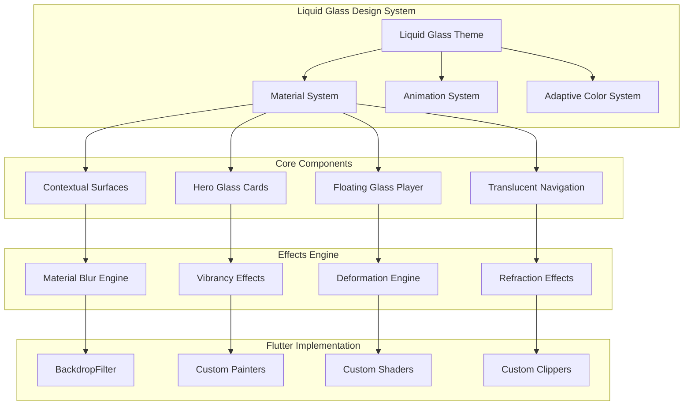

# OmniSonic Liquid Glass UI Design Document

## Overview

Il redesign dell'interfaccia utente di OmniSonic implementa il design system Liquid Glass di Apple per creare un'esperienza visiva premium e all'avanguardia. Il design si basa su materiali traslucidi avanzati, effetti di vibrancy dinamici e animazioni fluide che si integrano perfettamente con l'architettura esistente dell'applicazione.

Il sistema utilizza Flutter con widget personalizzati per implementare effetti Liquid Glass nativi, garantendo performance ottimali e coerenza visiva su tutte le piattaforme supportate.

## Architecture

### Design System Architecture



### Component Hierarchy

**Theme Layer:**
- Liquid Glass Theme Provider
- Adaptive Material System
- Dynamic Color Extraction
- Performance Optimization Manager

**Component Layer:**
- Contextual Surface Components
- Hero Glass Card Components
- Floating Glass Player Components
- Translucent Navigation Components

**Effects Layer:**
- Material Blur Engine
- Vibrancy Effect System
- Deformation Animation Engine
- Refraction Effect Processor

## Components and Interfaces

### Core Design Components

#### 1. Liquid Glass Theme System
```dart
class LiquidGlassTheme {
  final MaterialBlurConfig blurConfig;
  final VibrancyConfig vibrancyConfig;
  final AdaptiveColorScheme colorScheme;
  final AnimationConfig animationConfig;
  final PerformanceConfig performanceConfig;
  
  const LiquidGlassTheme({
    required this.blurConfig,
    required this.vibrancyConfig,
    required this.colorScheme,
    required this.animationConfig,
    required this.performanceConfig,
  });
}

class MaterialBlurConfig {
  final double intensity;
  final BlurStyle style;
  final Color tintColor;
  final double tintOpacity;
  final bool adaptiveIntensity;
  
  const MaterialBlurConfig({
    this.intensity = 20.0,
    this.style = BlurStyle.normal,
    this.tintColor = Colors.white,
    this.tintOpacity = 0.1,
    this.adaptiveIntensity = true,
  });
}

class VibrancyConfig {
  final VibrancyMode mode;
  final double intensity;
  final bool adaptToContent;
  final Duration transitionDuration;
  
  const VibrancyConfig({
    this.mode = VibrancyMode.auto,
    this.intensity = 0.8,
    this.adaptToContent = true,
    this.transitionDuration = Duration(milliseconds: 300),
  });
}
```

#### 2. Contextual Surface System
```dart
abstract class ContextualSurface extends StatefulWidget {
  final Widget child;
  final SurfaceType type;
  final AdaptiveBehavior adaptiveBehavior;
  final BlurIntensity blurIntensity;
  final VibrancyEffect vibrancyEffect;
  
  const ContextualSurface({
    Key? key,
    required this.child,
    required this.type,
    this.adaptiveBehavior = AdaptiveBehavior.auto,
    this.blurIntensity = BlurIntensity.medium,
    this.vibrancyEffect = VibrancyEffect.auto,
  }) : super(key: key);
}

class LiquidGlassSurface extends ContextualSurface {
  final BorderRadius? borderRadius;
  final EdgeInsets? padding;
  final DeformationConfig? deformationConfig;
  final RefractionConfig? refractionConfig;
  
  const LiquidGlassSurface({
    Key? key,
    required Widget child,
    SurfaceType type = SurfaceType.card,
    this.borderRadius,
    this.padding,
    this.deformationConfig,
    this.refractionConfig,
    AdaptiveBehavior adaptiveBehavior = AdaptiveBehavior.auto,
    BlurIntensity blurIntensity = BlurIntensity.medium,
    VibrancyEffect vibrancyEffect = VibrancyEffect.auto,
  }) : super(
    key: key,
    child: child,
    type: type,
    adaptiveBehavior: adaptiveBehavior,
    blurIntensity: blurIntensity,
    vibrancyEffect: vibrancyEffect,
  );
}
```

#### 3. Hero Glass Card System
```dart
class HeroGlassCard extends StatefulWidget {
  final Widget content;
  final String? heroTag;
  final ImageProvider? backgroundImage;
  final AdaptiveColorExtraction colorExtraction;
  final GlassCardStyle style;
  final VoidCallback? onTap;
  final Duration animationDuration;
  
  const HeroGlassCard({
    Key? key,
    required this.content,
    this.heroTag,
    this.backgroundImage,
    this.colorExtraction = AdaptiveColorExtraction.auto,
    this.style = GlassCardStyle.elevated,
    this.onTap,
    this.animationDuration = const Duration(milliseconds: 400),
  }) : super(key: key);
}

class GlassCardStyle {
  final double elevation;
  final BorderRadius borderRadius;
  final EdgeInsets padding;
  final BlurIntensity blurIntensity;
  final VibrancyIntensity vibrancyIntensity;
  final DeformationStyle deformationStyle;
  
  const GlassCardStyle({
    this.elevation = 8.0,
    this.borderRadius = const BorderRadius.all(Radius.circular(16.0)),
    this.padding = const EdgeInsets.all(16.0),
    this.blurIntensity = BlurIntensity.high,
    this.vibrancyIntensity = VibrancyIntensity.medium,
    this.deformationStyle = DeformationStyle.subtle,
  });
  
  static const GlassCardStyle elevated = GlassCardStyle();
  static const GlassCardStyle floating = GlassCardStyle(
    elevation: 12.0,
    deformationStyle: DeformationStyle.prominent,
  );
  static const GlassCardStyle inline = GlassCardStyle(
    elevation: 4.0,
    blurIntensity: BlurIntensity.low,
  );
}
```

#### 4. Floating Glass Player
```dart
class FloatingGlassPlayer extends StatefulWidget {
  final PlayerState playerState;
  final VoidCallback? onExpand;
  final VoidCallback? onMinimize;
  final PlayerControlsConfig controlsConfig;
  final AdaptiveArtworkConfig artworkConfig;
  final AnimationConfig animationConfig;
  
  const FloatingGlassPlayer({
    Key? key,
    required this.playerState,
    this.onExpand,
    this.onMinimize,
    this.controlsConfig = const PlayerControlsConfig(),
    this.artworkConfig = const AdaptiveArtworkConfig(),
    this.animationConfig = const AnimationConfig(),
  }) : super(key: key);
}

class PlayerControlsConfig {
  final bool showPrevious;
  final bool showNext;
  final bool showShuffle;
  final bool showRepeat;
  final ControlStyle style;
  final GlassEffectIntensity glassIntensity;
  
  const PlayerControlsConfig({
    this.showPrevious = true,
    this.showNext = true,
    this.showShuffle = true,
    this.showRepeat = true,
    this.style = ControlStyle.glass,
    this.glassIntensity = GlassEffectIntensity.high,
  });
}

class AdaptiveArtworkConfig {
  final bool extractColors;
  final bool applyVibrancy;
  final bool enableReflections;
  final ReflectionIntensity reflectionIntensity;
  final Duration colorTransitionDuration;
  
  const AdaptiveArtworkConfig({
    this.extractColors = true,
    this.applyVibrancy = true,
    this.enableReflections = true,
    this.reflectionIntensity = ReflectionIntensity.medium,
    this.colorTransitionDuration = const Duration(milliseconds: 500),
  });
}
```

## Data Models

### Design System Models

```dart
// Adaptive Color System
class AdaptiveColorScheme {
  final Color primary;
  final Color secondary;
  final Color surface;
  final Color background;
  final Color onSurface;
  final Color onBackground;
  final List<Color> accentColors;
  final ColorExtractionSource source;
  final DateTime extractedAt;
  
  const AdaptiveColorScheme({
    required this.primary,
    required this.secondary,
    required this.surface,
    required this.background,
    required this.onSurface,
    required this.onBackground,
    required this.accentColors,
    required this.source,
    required this.extractedAt,
  });
  
  factory AdaptiveColorScheme.fromImage(ImageProvider image) {
    // Implementation for color extraction from artwork
  }
  
  AdaptiveColorScheme copyWith({
    Color? primary,
    Color? secondary,
    // ... other parameters
  }) {
    return AdaptiveColorScheme(
      primary: primary ?? this.primary,
      secondary: secondary ?? this.secondary,
      // ... other assignments
    );
  }
}

// Material Configuration
class MaterialConfig {
  final BlurStyle blurStyle;
  final double blurIntensity;
  final Color tintColor;
  final double tintOpacity;
  final VibrancyMode vibrancyMode;
  final double vibrancyIntensity;
  final bool adaptiveIntensity;
  final PerformanceMode performanceMode;
  
  const MaterialConfig({
    this.blurStyle = BlurStyle.normal,
    this.blurIntensity = 20.0,
    this.tintColor = Colors.white,
    this.tintOpacity = 0.1,
    this.vibrancyMode = VibrancyMode.auto,
    this.vibrancyIntensity = 0.8,
    this.adaptiveIntensity = true,
    this.performanceMode = PerformanceMode.balanced,
  });
}

// Animation Configuration
class AnimationConfig {
  final Duration defaultDuration;
  final Duration fastDuration;
  final Duration slowDuration;
  final Curve defaultCurve;
  final Curve elasticCurve;
  final Curve liquidCurve;
  final bool enableHighFrameRate;
  final int targetFrameRate;
  
  const AnimationConfig({
    this.defaultDuration = const Duration(milliseconds: 300),
    this.fastDuration = const Duration(milliseconds: 150),
    this.slowDuration = const Duration(milliseconds: 600),
    this.defaultCurve = Curves.easeInOutCubic,
    this.elasticCurve = Curves.elasticOut,
    this.liquidCurve = const Cubic(0.25, 0.46, 0.45, 0.94),
    this.enableHighFrameRate = true,
    this.targetFrameRate = 120,
  });
}

// Performance Configuration
class PerformanceConfig {
  final PerformanceMode mode;
  final bool adaptiveQuality;
  final int maxBlurRadius;
  final bool enableGPUAcceleration;
  final bool enableCaching;
  final CacheStrategy cacheStrategy;
  
  const PerformanceConfig({
    this.mode = PerformanceMode.balanced,
    this.adaptiveQuality = true,
    this.maxBlurRadius = 30,
    this.enableGPUAcceleration = true,
    this.enableCaching = true,
    this.cacheStrategy = CacheStrategy.intelligent,
  });
}

// Enums for configuration
enum BlurStyle { normal, outer, inner, solid }
enum VibrancyMode { auto, light, dark, prominent, regular }
enum PerformanceMode { battery, balanced, performance }
enum SurfaceType { card, overlay, navigation, player, modal }
enum BlurIntensity { low, medium, high, ultra }
enum VibrancyIntensity { subtle, medium, prominent }
enum DeformationStyle { none, subtle, prominent, dramatic }
enum GlassEffectIntensity { minimal, low, medium, high, ultra }
enum ReflectionIntensity { none, subtle, medium, prominent }
enum CacheStrategy { none, basic, intelligent, aggressive }
```

## Correctness Properties

*A property is a characteristic or behavior that should hold true across all valid executions of a system-essentially, a formal statement about what the system should do. Properties serve as the bridge between human-readable specifications and machine-verifiable correctness guarantees.*

Prima di scrivere le proprietà di correttezza, analizzerò i criteri di accettazione per determinare quali sono testabili:

<function_calls>
<invoke name="prework">
<parameter name="featureName">spotify-glass-ui

### Property Reflection

Dopo aver analizzato tutti i criteri di accettazione, tutti risultano testabili come proprietà. Tuttavia, alcune possono essere consolidate per eliminare ridondanza:

**Consolidazioni:**
- Le proprietà 1.1, 1.2, 1.3 possono essere combinate in una proprietà comprensiva sui materiali liquid glass di base
- Le proprietà 2.1, 2.2, 2.3 possono essere combinate in una proprietà sulla navigazione fluida
- Le proprietà 3.1, 3.2, 3.3, 3.5 possono essere combinate in una proprietà sul player floating
- Le proprietà 4.1, 4.2, 4.3 possono essere combinate in una proprietà sulle card e liste
- Le proprietà 5.1, 5.2, 5.3 possono essere combinate in una proprietà sui materiali adattivi
- Le proprietà 6.1, 6.3, 6.4, 6.5 possono essere combinate in una proprietà sulle animazioni fluide
- Le proprietà 7.1, 7.2, 7.3, 7.5 possono essere combinate in una proprietà sui menu contestuali
- Le proprietà 8.1, 8.2, 8.3, 8.4 possono essere combinate in una proprietà sull'adattabilità

Questo riduce la ridondanza mantenendo una copertura completa di tutti i requisiti funzionali.

### Core Correctness Properties

**Property 1: Liquid Glass Material Application**
*For any* UI component in the application, when displayed, it should apply appropriate liquid glass materials (blur, vibrancy, translucency) based on its type and context, maintaining visual consistency and performance.
**Validates: Requirements 1.1, 1.2, 1.3, 1.4, 1.5**

**Property 2: Fluid Navigation Transitions**
*For any* navigation action between screens or sections, the system should use liquid glass transitions with appropriate hero animations, maintaining visual continuity and contextual awareness.
**Validates: Requirements 2.1, 2.2, 2.3, 2.4, 2.5**

**Property 3: Floating Player Glass Integration**
*For any* music playback state, the floating glass player should appear with appropriate liquid glass effects, adaptive artwork integration, and smooth expand/minimize transitions.
**Validates: Requirements 3.1, 3.2, 3.3, 3.4, 3.5**

**Property 4: Card and List Glass Presentation**
*For any* content display (albums, playlists, tracks), the system should use hero glass cards and translucent list elements with appropriate artwork integration and selection feedback.
**Validates: Requirements 4.1, 4.2, 4.3, 4.4, 4.5**

**Property 5: Adaptive Material System**
*For any* artwork or theme change, the system should extract dominant colors and apply them to liquid glass elements while maintaining elegance and readability through automatic corrections.
**Validates: Requirements 5.1, 5.2, 5.3, 5.4, 5.5**

**Property 6: Fluid Animation Performance**
*For any* UI animation or transition, the system should maintain target frame rates (120 FPS where supported) while providing organic, natural movement with appropriate liquid glass deformations.
**Validates: Requirements 6.1, 6.2, 6.3, 6.4, 6.5**

**Property 7: Contextual Menu Glass Effects**
*For any* contextual menu, dropdown, or overlay, the system should materialize with liquid glass effects, maintain readability through material blur, and dematerialize with coordinated animations.
**Validates: Requirements 7.1, 7.2, 7.3, 7.4, 7.5**

**Property 8: Adaptive Accessibility and Performance**
*For any* device capability or accessibility setting, the system should adapt liquid glass effects appropriately while maintaining core aesthetics and ensuring full accessibility compliance.
**Validates: Requirements 8.1, 8.2, 8.3, 8.4, 8.5**

## Error Handling

### Visual Effect Error Handling
- **Shader Compilation Failures**: Graceful fallback to standard materials
- **Performance Degradation**: Automatic quality reduction with user notification
- **Memory Constraints**: Intelligent caching and effect simplification
- **GPU Limitations**: Platform-specific optimization and fallbacks

### Animation Error Handling
- **Frame Rate Drops**: Dynamic quality adjustment and effect reduction
- **Animation Interruptions**: Smooth state recovery and continuation
- **Gesture Conflicts**: Priority-based gesture handling and visual feedback
- **Transition Failures**: Fallback to standard transitions with error logging

### Color Extraction Error Handling
- **Invalid Image Data**: Fallback to default color schemes
- **Extraction Failures**: Retry mechanism with cached color fallbacks
- **Color Accessibility Issues**: Automatic contrast adjustment and validation
- **Performance Impact**: Asynchronous processing with loading states

## Testing Strategy

### Dual Testing Approach

La strategia di testing utilizza sia unit testing che property-based testing per garantire copertura completa:

**Unit Testing:**
- Esempi specifici di comportamenti corretti
- Punti di integrazione tra componenti
- Casi limite e condizioni di errore
- Funzionalità specifiche della piattaforma

**Property-Based Testing:**
- Proprietà universali che devono valere per tutti gli input
- Configurato per eseguire minimo 100 iterazioni per test
- Ogni property test taggato con formato: **Feature: spotify-glass-ui, Property {number}: {property_text}**
- Utilizza la libreria `fast_check` per Dart/Flutter property-based testing

**Testing Framework Configuration:**
- Framework primario: `flutter_test` per unit test
- Property-based testing: `fast_check` package per Dart
- Integration testing: `integration_test` package per scenari end-to-end
- Mock framework: `mockito` per isolamento delle dipendenze
- Visual testing: `golden_toolkit` per regression testing visuale

**Test Organization:**
- Unit test co-locati con file sorgente usando suffisso `.test.dart`
- Property test in directory dedicata `test/properties/`
- Integration test in directory `integration_test/`
- Test utilities e fixtures in `test/helpers/`
- Visual regression test in `test/golden/`

**Coverage Requirements:**
- Minimo 80% code coverage per logica di business core
- 100% coverage per percorsi critici (rendering effetti, animazioni, accessibilità)
- Property test devono validare tutte le 8 proprietà di correttezza
- Integration test devono coprire workflow utente completi
- Visual test devono coprire tutti i componenti liquid glass

### Performance Testing
- Misurazione frame rate durante animazioni complesse
- Profiling memoria durante rendering effetti intensivi
- Analisi consumo batteria per effetti liquid glass
- Benchmark performance su dispositivi di fascia bassa

### Visual Regression Testing
- Screenshot automatici di componenti liquid glass
- Confronto pixel-perfect per consistency visuale
- Test cross-platform per coerenza rendering
- Validazione effetti blur e vibrancy

### Accessibility Testing
- Compatibilità screen reader con elementi liquid glass
- Test contrasto colori con materiali traslucidi
- Validazione navigazione keyboard
- Test riduzione movimento per accessibilità

## Implementation Notes

### Flutter Liquid Glass Implementation
- Utilizzo di `BackdropFilter` con `ImageFilter.blur` per effetti base
- Custom `CustomPainter` per effetti vibrancy avanzati
- Implementazione shader personalizzati per deformazioni liquid
- Ottimizzazione rendering con `RepaintBoundary` strategici

### Performance Optimization
- Caching intelligente di effetti blur computazionalmente costosi
- Utilizzo di `Opacity` widget per transizioni fluide
- Implementazione lazy loading per effetti complessi
- Degradazione automatica qualità basata su performance device

### Platform-Specific Considerations
- iOS: Integrazione con `UIVisualEffectView` per performance native
- Android: Utilizzo di `RenderEffect` API per blur hardware-accelerated
- Desktop: Ottimizzazioni per schermi ad alta risoluzione
- Web: Fallback CSS per effetti non supportati

### Color Extraction and Adaptation
- Utilizzo di algoritmi di clustering per estrazione colori dominanti
- Implementazione correzione automatica contrasto
- Cache colori estratti per performance
- Transizioni fluide tra palette colori diverse

### Animation System
- Implementazione custom `Tween` per deformazioni liquid glass
- Utilizzo di `AnimationController` con curve personalizzate
- Sincronizzazione animazioni multiple per effetti coordinati
- Ottimizzazione timeline animazioni per 120 FPS target

### Accessibility Integration
- Implementazione `Semantics` appropriati per elementi glass
- Supporto per impostazioni riduzione movimento
- Adattamento automatico contrasti per visibilità
- Mantenimento navigazione logica con effetti visivi complessi